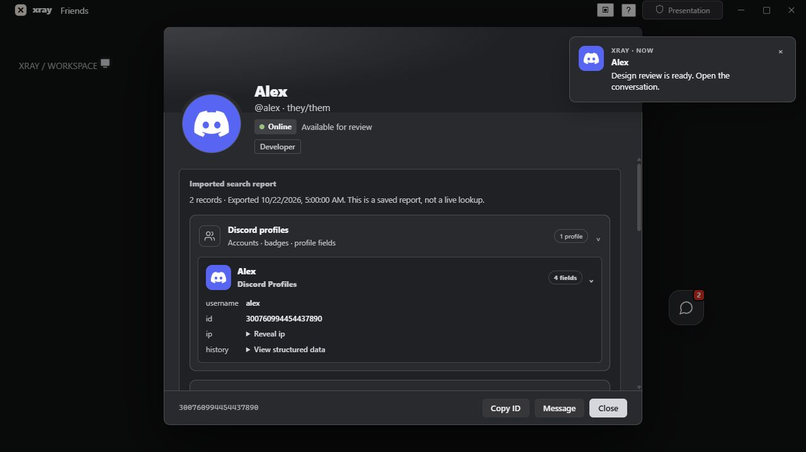

# XRay implementation and companion architecture

Status: October 22, 2026. This distinguishes the implemented release from proposed backend work.

## Implemented in this release

| Feature | Behavior and limits |
| --- | --- |
| FakeDM and message editing | FakeDM is bundled. Local message edits affect this session's display and can be reset; they do not edit another person's server-side message. |
| Profile/report UI | Full returned Oathnet profile fields and history, badge images, expandable source groups and record cards, supplied avatars, complete exported payload, and reveal controls for sensitive imported fields. Missing data remains unavailable. |
| Relationships | Returned shared servers are clickable when available to this account. Returned mutual friends open profiles; known server membership comes only from already loaded membership data. This is not a complete social graph. |
| Message counts | Per-server and combined counts from loaded channel caches, deduplicated by message ID. Coverage and unknown servers are explicit. No lifetime-total claim or history crawl. |
| Mini-chat | Files, image/GIF/video/audio attachments, supported link embeds, Discord invite links, and exact message timestamps. The launcher drags, saves its position and supports Alt + arrow keys. |
| Intelligence workspace | Off by default; enabling it adds an entry beneath Friends and a panel button. Reports, IntelX and Snusbase tabs import local authorized JSON exports. Supported Oathnet HTML exports extract only their JSON data block. There is no live IntelX/Snusbase search connector. |
| Recording downloads | Preview a provided audio/video recording and save a copy. This does not record a current voice call. |
| Presentation mode | Top-right toggle hides XRay intelligence sheets, panel, mini-chat and new notification previews. It does not remove previously delivered Windows notification history. |
| Notifications | Themed in-app cards while focused; native Windows toasts otherwise, with bounded sender-avatar caching and privacy composition. Windows controls the native toast frame. |
| Voice troubleshooting | Panel and command-palette action shows output volume, attenuation, current participant volume settings and AudioLimiter status. It changes no volume settings and captures no audio. |
| Themes | Graphite default, Space Gray, Silver, Off-white and legacy Mist & Oak. Device icons are neutral with a static restrained glow, separate from semantic presence/error colors. |

The supplied HTML export contains two public profile records. Screenshot-only breach rows are not present in its JSON payload and are not fabricated. IP fields can be displayed when present in an authorized imported report; Discord's user API has no private IP field. [Discord user resource](https://docs.discord.com/developers/resources/user)

The existing Oathnet helper reads `C:\Users\xnx\Vencord\src\userplugins\oathnetProfile\.env`. XRay calls only its fixed local profile/history routes through Rust; the key is not embedded in the frontend bundle. The saved report is private local data under `%APPDATA%\app.xray.desktop\oathnet-reports\<discord-id>.json`.

## Running alongside regular Discord

| Option | Feasible use | Constraint |
| --- | --- | --- |
| Separate Tauri companion + official bot/OAuth | Recommended. Native search, local indexed data, reports and notifications; ordinary Discord handles chats and calls. | Bot can access only installed/authorized guilds and permitted channels. OAuth grants are scoped and do not supply arbitrary users' private graphs. |
| Companion overlay | Optional always-on-top UI over Discord, driven by the same authorized backend. | Drawing an overlay grants no additional Discord access. Global user-account automation and private scraping remain outside the supported design. |
| Browser UI + backend | Feasible alternative using the same authenticated service and search index. | Bot/provider secrets belong on the backend. Browser UI has additional desktop notification, filesystem and overlay limits. |
| Current XRay embedded client | Runs in a separate process and WebView2 profile without replacing regular Discord. | It is an unofficial modified client, not the completed official-API companion architecture. |

Do not build the companion around a normal account token. Discord prohibits automated normal-user accounts outside its OAuth/bot API. [Discord self-bot policy](https://support.discord.com/hc/en-us/articles/115002192352-Automated-User-Accounts-Self-Bots)

OAuth `identify`, `guilds` and connections concern the consenting user and approved scopes. Do not assume generic friend-list, DM or RPC voice access: relationship/social and RPC scopes have application/access requirements. [OAuth2 scopes](https://docs.discord.com/developers/topics/oauth2)

## Recommended implementation

Keep the native UI as a distinct local frontend. Add a Rust service boundary for bot authorization, OAuth sessions, authorized imports and search. Keep bot/provider credentials in OS-protected storage or a separately managed server, never the Discord page. Use explicit response models with source, fetched/exported time, permissions and coverage fields; preserve the original authorized payload separately for inspection.

Store permitted messages in SQLite with FTS5 and indexes on guild, channel, author and timestamp. Paginate results and render only visible rows. Ingest permitted gateway events, reconcile edits/deletions and resume backfills from checkpoints. Delete or invalidate records on access loss. A local index can be faster for data it has indexed; benchmark warm/cold queries and memory before claiming superiority over Discord.

Discord now documents a guild-message search endpoint. It requires `READ_MESSAGE_HISTORY`, is affected by `MESSAGE_CONTENT` access, can return indexing status, and warns that `total_results` may be approximate during changes/indexing. Use it only within bot permissions; it is not an exact lifetime counter. [Search guild messages](https://docs.discord.com/developers/resources/message#search-guild-messages)

For exact counts of the retained messages in an authorized corpus, deduplicate complete accessible backfills and apply subsequent gateway changes. Report index completeness, retention period, inaccessible channels and last reconciliation time. Never label an incomplete sample as every message someone has ever sent. Respect request bucket headers and `429` retry delays. [Rate limits](https://docs.discord.com/developers/topics/rate-limits)

Shared servers can be computed by intersecting the consenting user's accessible guilds with bot-visible memberships. A bot cannot enumerate an arbitrary person's entire guild list. List-member operations may require the privileged members intent. Mutual friends require explicit participant data and permitted relationship access; server co-membership alone is not friendship. [Guild/member API](https://docs.discord.com/developers/resources/guild)

For voice, offer manual navigation to visible channels first. An opt-in bot can join allowed channels using its own voice state; automatically moving a normal user account is not the recommended architecture. Recording needs a visible participating bot, participant consent, clear start/stop indicators, retention controls and an authenticated download endpoint. Select a maintained voice stack that supports the current transport and DAVE encryption protocol, and validate receive support before promising capture. [Voice protocol](https://docs.discord.com/developers/topics/voice-connections)

IntelX/Snusbase work should remain scoped to authorized security datasets and the team's own exposures. Future connectors need a documented permitted use, backend-held keys, provider-specific normalization and visible provenance. Local imports are implemented; live person-to-private-IP or credential lookup is not.

## Prioritized build order and acceptance criteria

1. **Release UI and correctness (implemented here):** contrast-checked palettes, grouped reports, profile actions, draggable mini-chat, presentation privacy, voice diagnostic controls, tests and release build. Runtime Discord store/class changes remain a compatibility risk.
2. **Official companion foundation:** registered bot/OAuth application, permitted guild selection, secure credential storage, explicit permission checks and a standalone local frontend. Acceptance: regular Discord works independently and no user-account token is needed.
3. **Search and counts:** SQLite/FTS5, bounded ingestion, checkpointed permitted backfills and coverage UI. Acceptance: reproducible count fixtures, edit/delete/access-loss tests, rate-limit recovery and measured query latency.
4. **Relationship detail:** permitted membership intersections and consented friend data, with provenance and unknown states. Acceptance: no inaccessible guilds, no inferred friendships and no duplicate totals.
5. **Recording service:** announced opt-in bot sessions, tested voice/encryption support, participant controls and authenticated downloads. Acceptance: start/stop/leave handling and consent/retention controls verified in a team test server.
6. **Optional connectors and overlay:** scoped authorized datasets and OS overlay ergonomics only after the service boundary and permission tests are in place.

## Theme extension

`core/src/theme/palettes.ts` owns semantic surface, text, accent, border and wash roles. `ui/appearance.ts` applies the chosen roles both to XRay's isolated UI and Discord's existing token containers. Add a palette entry rather than copying component CSS. Keep photographs and badge art intact, make control icons neutral, and preserve labeled semantic errors/presence. Small device-icon glows are static; increased contrast, forced colors and reduced transparency remove them. Content surfaces remain opaque and large areas do not animate or blur.

Lucide SVGs are bundled locally through `ui/icons.ts`, so no icon service or design MCP is needed. The automated palette checks enforce readable small text and action labels. Windows owns native toast styling; the app can provide identity, avatar and content, while its own in-app notification cards can follow the selected palette. [Windows notification content](https://learn.microsoft.com/en-us/windows/apps/develop/notifications/app-notifications/app-notifications-content?tabs=xml)

The following browser UI check uses sample data and the actual component/style modules; it is not a screenshot of a live Discord account.

## Validation scope

Core tests cover profile data states and navigation, cache-count deduplication, report import isolation/precision, Oathnet response errors and retries, local edit behavior, mini-chat media URL handling, timestamp rendering, palette contrast, bubble bounds and notification privacy. Rust unit tests cover fixed helper routes, allowed avatar URLs, request guards and the existing native logic. A local browser fixture exercises actual UI components for dragging, header sizing, presentation hiding, theme switching and intelligence navigation.

These checks do not establish live VC loudness, successful native toast delivery on every Windows installation, complete third-party provider availability, or exact historical message coverage. A real team call and installed-app notification test remain necessary for those claims.
