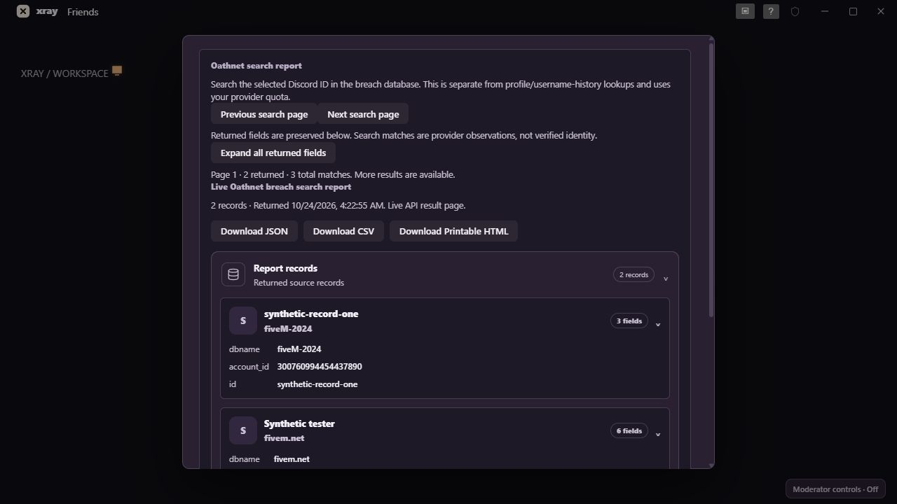

# XRay 0.5.4 — complete returned Oathnet data and accessible history

The full-profile lookup previously fetched the Oathnet profile and username history without fetching the breach-search report. This update makes **Load full report** also request the selected Discord ID's search results. Intelligence uses the same report renderer and pagination.

## Using the report

Open a full profile and select **Load full report**, then scroll to **Oathnet search report**. Every field supplied in each returned record is retained, including nested objects and fields such as IP addresses when supplied. Record cards start expanded. Sensitive and structured fields have disclosure controls; **Expand all returned fields** opens them together. The complete API response is also available below the cards. JSON, CSV and printable HTML exports preserve the page's source payload.

The initial request asks for 100 records. **Next search page** requests the provider's opaque cursor; **Previous search page** reuses cached data. Up to ten pages are cached in memory. Each new page is explicitly requested and uses the provider's quota. A failed next-page request keeps the current results and retries the same cursor. Exports describe the selected page, not an automatic aggregation of all pages.

All profile fields are now available in an expanded details card alongside the existing profile summary, badges and username history. Opening a profile alone does not spend provider credits. Loading the report does.

## Message history

The timeline initially renders the latest 40 retained observations. **Show older history** adds 40 at a time until every retained entry is visible. If remote storage fails to load, the view explains that data has not loaded and provides **Retry loading history**. The storage session releases a failed read so this retry can succeed without restarting. No failed read is treated as an empty document or used to overwrite the server copy.

Existing retention and storage limits are unchanged: up to 200 events per profile, 2,000 globally, the configured age limit and the bounded serialized document. Previously unobserved or discarded edits/deletions cannot be reconstructed. Expired attachment URLs can remain unavailable.

## Coverage and verification

This displays the records and fields returned by your API access. The website may run additional enrichment services or use different subscription permissions; the app does not invent missing fields or claim those separate services were queried. The cursor and response handling follow the [Oathnet pagination documentation](https://docs.oathnet.org/guides/pagination).

The TypeScript checks and full core test suite pass, including complete field rendering, cursor navigation, failed-page retry, failed remote-history recovery, and paging through 85 retained observations. All 24 native tests pass, including fixed-endpoint cursor encoding and rejection of cursors for other providers. The server suite passes. One authorized live API request verified the current response envelope and returned ten search records; private record values were not saved in test fixtures.

Browser verification used synthetic records to check page navigation, expanded IP/nested fields and the existing dark report styling. The screenshot below contains synthetic data only. Native installer/startup verification and distribution checks are recorded with the final delivery. The installer is unsigned.

Final delivery verification: the optimized 0.5.4 application and NSIS installer built successfully. The updated executable was restarted and remained responding with a nonzero main-window handle, version 0.5.4, empty error output and no Application crash events since launch. The installer and matching source archive passed integrity, source-freshness and known-credential scans; the friend-share archive includes the source, notices and SHA-256 checksums. Native interaction with a signed-in Discord session and every provider subscription remains a manual session check.

## Changed files

| Files | Purpose |
| --- | --- |
| `core/src/ui/oathnetSearch.ts`, `oathnet.ts`, `liveIntel.ts` | Full returned search records, profile fields and manual cursor navigation |
| `core/src/ui/importedReport.ts` | Accurate live-result labels and record counts |
| `src-tauri/src/intelligence.rs` | Validated opaque cursor on the fixed Oathnet endpoint |
| `core/src/ui/profileJournal.ts`, `core/src/history/index.ts` | Older timeline pages and visible retry state |
| `core/src/shell/documentSession.ts` | Retry failed reads without replacing stored data |
| `core/test/oathnet.test.ts`, `history-storage.test.ts`, `history-discord.fixture.ts` | Rendering, retry, paging and storage regression tests |
