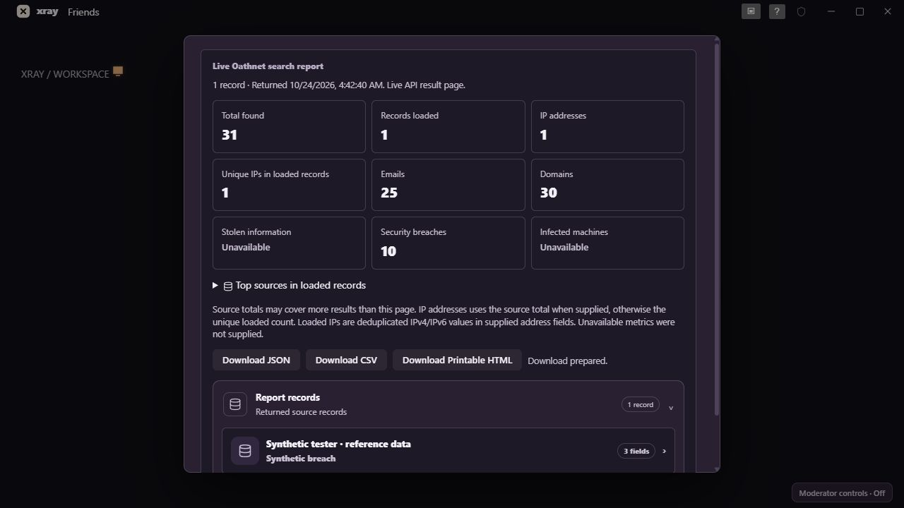
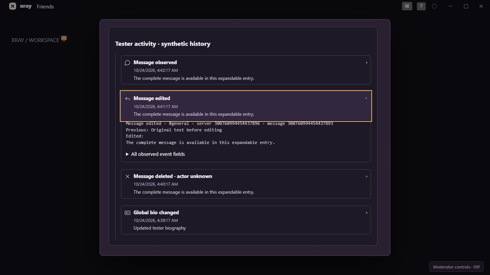

# XRay 0.5.5 — report accuracy and test-team polish

This is a scoped update to the existing Tauri/TypeScript/esbuild application. React/TSX remains part of the bundled plugin code; there is no Next.js application or framework migration. No libraries, plugin settings, API routes or permissions were added.

## IP results and summary counts

The supplied Oathnet HTML export contains `totals.records`, `totals.ips`, `totals.emails`, `totals.domains` and `totals.breach`. The previous report summary read `summary`/`metadata.summary` but ignored `totals`. It also had no IP count. Address fields remained in record payloads, sometimes behind a sensitive-field disclosure; the observed defect was incomplete summary/display handling, rather than a filter that removed IP records.

Reports now read both supported summary envelopes and the source's totals. The same computed report is used for the on-screen summary, JSON, CSV and printable HTML. Original source payloads remain included. Generic imported and profile-associated provider reports preserve their totals and original responses too.

**Total found** preserves an explicit source total. **Records loaded** describes the current returned collection. **IP addresses** preserves an explicit source IP total when supplied, otherwise it uses the unique loaded count. **Unique IPs in loaded records** deduplicates valid IPv4/IPv6 values in explicit address fields, including structured fields, arrays and JSON strings. It does not count Discord IDs or numeric identifiers as addresses. Source totals can exceed a single loaded page and overlapping email/domain/IP counts are not summed to manufacture a total.

Stolen-information and infected-machine counts remain **Unavailable** when those exact metrics are absent. Credential or victim record counts do not by themselves establish unique infected machines. The complete source response retains those fields for inspection. Top-source counts explicitly describe loaded records.

## Inspectable entries and smoothness

Records without an available profile photo use bundled Lucide database, account or gaming icons. Clicking a record opens every supplied field; sensitive and structured fields retain their disclosure controls. Supplied profile images keep the existing image/fallback behavior.

Message observations, edits, deletions, presence and profile changes now use icon-led disclosure rows. Each entry reveals its full retained text, observation time, known conversation, image references and all raw observed fields. Edit details retain previous/edited text when available. Native disclosure controls support keyboard activation.

Long event bodies and image controls are created only on first expansion. The existing `StableRows` and `reconcileChildren` utilities now retain unchanged history rows, including open disclosures and loaded attachment controls, when older pages are added. A precomputed deleted-message set replaces repeated scans of the event list. Save-status notifications no longer invalidate an already-loaded timeline.

Report/history hover feedback uses the existing 100 ms motion token. Scroll regions reserve a stable scrollbar gutter and contain scroll chaining. Reduced-motion behavior remains supported. The new components reuse `docs/DESIGN.md` and `core/src/theme/tokens.ts` for surfaces, colors, typography, spacing and timing; the purple appearance in the screenshots is the existing selectable Halloween palette. Glass stays on the floating layer.

The release core bundle is 493.3 kB versus 488.0 kB in 0.5.4, as reported by esbuild: a 5.3 kB increase (about 1.1%) for the metrics and detail UI. These are rendering and interaction improvements, not a measured claim of higher screen-share FPS or whole-app superiority over Discord. No idle animation loop was added.

## Validation

The full core suite (85 TAP tests plus the existing core checks), TypeScript checks, all 24 native tests and the server suite pass. New regression tests cover source totals, IPv4/IPv6 deduplication, nested/stringified IP fields, consistent CSV/JSON/HTML output, generic import preservation, bundled record icons, lazy event details and retained disclosure DOM across timeline pages. Existing DM/search, clipboard, image viewer, retention, plugin and installer checks remain in the suite.

Browser fixtures verified the summary counts, breach drill-down, history edit details and keyboard disclosure. Actual synthetic JSON and CSV downloads were parsed and their IP and total counts matched the visible report. Screenshots contain synthetic data only. Native signed-in voice, capture performance, Windows notifications and provider-plan combinations remain test-team session checks.

## Files changed

| Files | Purpose |
| --- | --- |
| `core/src/ui/reportExport.ts` | Shared IP/source metrics, visible summary and consistent exports |
| `core/src/ui/importedReport.ts` | Summary display, source icons and singular/plural labels |
| `core/src/ui/intelligence.ts` | Preserve totals and original payloads on generic imports |
| `core/src/ui/liveIntel.ts` | Visible metrics and complete profile-associated results |
| `core/src/ui/profileJournal.ts` | Lazy, inspectable event rows and stable timeline rendering |
| `core/src/ui/messageBrowser.ts` | Reuse the event drill-down in message reports |
| `core/src/ui/styles.ts` | Existing-theme summary cards, disclosure states and scroll polish |
| `core/test/reports.test.ts`, `oathnet.test.ts`, `history-storage.test.ts` | Metrics, exports, detail rendering and DOM-retention regressions |
| Version manifests, README and release/test documents | Matching test-team build and verification instructions |

See [the test-team checks](TEST_TEAM_0.5.5.md) and the [0.5.3](RELEASE_0.5.3.md)/[0.5.4](RELEASE_0.5.4.md) notes for the previously completed message/image/report changes and their data limits.

Final delivery checks: the optimized 0.5.5 executable and NSIS installer built successfully. The restarted application reports version 0.5.5, remains responding with a nonzero main-window handle, and has no error output or Application crash events since launch. Matching-source, archive-integrity, source-freshness and known-credential/private-endpoint checks passed. The unsigned friend-share package includes the installer, matching source, notices and SHA-256 checksums.
